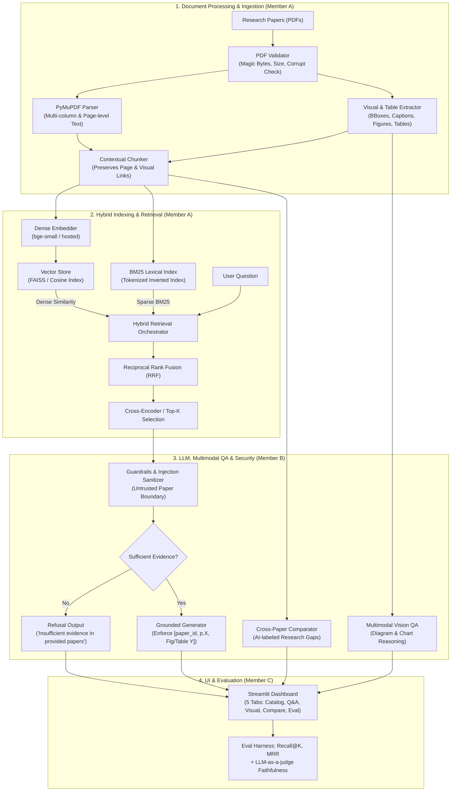

# ResearchIQ: Multimodal AI Research Assistant

ResearchIQ is a multimodal AI research assistant built for a one-day hackathon, specifically designed to ingest, retrieve, cross-examine, and synthesize findings across 8–10 research papers on **Advanced Retrieval-Augmented Generation (RAG)**.

Unlike basic document chatbots that dump raw PDFs into an LLM context window, ResearchIQ implements an end-to-end, reproducible pipeline:
```
PDF Ingestion -> Visual/Table Extraction -> Page-Aware Chunking -> Hybrid Indexing (Dense + BM25) -> Reciprocal Rank Fusion & Reranking -> Grounded Generation with Strict Citations [paper_id, p.X, Fig/Table Y] -> Evaluation Harness
```

---

## 1. Research Topic & Paper Collection

**Topic**: Advanced Retrieval-Augmented Generation (Hybrid Search, GraphRAG, Multimodal RAG, Reranking, Table/Text Document Intelligence).

The papers catalogue is maintained in [`papers_catalogue.csv`](./papers_catalogue.csv).
All 8 included papers are recent open-access publications (ACL 2026, Springer Discover AI 2026, arXiv 2026) covering:
1. `P01`: *Scaling Beyond Context: Survey of Multimodal RAG* (ACL 2026)
2. `P02`: *Deep GraphRAG: Balanced Approach to Hierarchical Retrieval* (arXiv:2601.11144, Ant Group)
3. `P03`: *MLDocRAG: Multimodal Long-Context Document RAG* (arXiv:2602.10271)
4. `P04`: *GraphER: Efficient Graph-Based Enrichment and Reranking* (arXiv:2603.24925, Oracle AI)
5. `P05`: *From BM25 to Corrective RAG: Benchmarking Text-and-Table Documents* (arXiv:2604.01733, TH Ingolstadt)
6. `P06`: *MultiDocFusion: Hierarchical and Multimodal Chunking Pipeline* (arXiv:2604.12352, Korea Univ)
7. `P07`: *Unified Framework for Context-Aware and Relation-Aware Graph RAG* (arXiv:2606.18075, Zhejiang Univ)
8. `P08`: *Study on GraphRAG Semantic Retrieval and Multi-Dimensional Analysis* (Springer 2026)

---

## 2. System Architecture



---

## 3. Quickstart

### Prerequisites
- Python 3.11+
- Virtual environment recommended

### Installation
```bash
pip install -r requirements.txt
cp .env.example .env
# Edit .env with your LLM API keys (e.g. GEMINI_API_KEY)
```

### Running Unit Tests
```bash
pytest tests/ -v
# Or on Windows PowerShell:
.\run.ps1 -Action test
```

### Launching Web Interface
```bash
streamlit run src/ui/app.py
# Or on Windows PowerShell:
.\run.ps1 -Action ui
```

---

## 4. Security & Compliance Principles
- **Untrusted Content Isolation**: Paper text is wrapped in strict `<paper_chunk>` XML tags and treated as untrusted data; paper content cannot override system instructions.
- **Traceable Citations**: Every claim is cited as `[paper_id, p.X, Fig/Table Y]`. Zero tolerance for hallucinated citations.
- **Fail-Safe Refusal**: When retrieved context lacks sufficient evidence, the system explicitly reports insufficient evidence rather than guessing.
- **Zero Secrets in Code**: All configuration is managed via `.env`. Stack traces and local file paths are masked before reaching the UI.
- **Transparent AI Gaps**: Extrapolated research opportunities are explicitly labeled: `[AI-GENERATED SUGGESTION]`.
